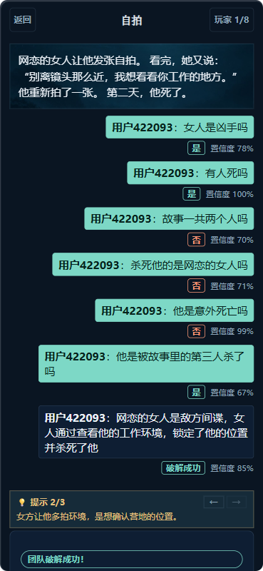
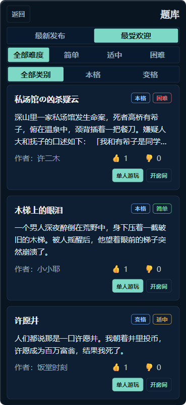

  

# AI 海龟汤

「我是 Jev，这碗汤的主持人。大胆提问，我只回答『是、否、无关』。」

中文 | [English](./README.en.md)

  
  
  

---

## 这是什么

海龟汤（情境猜谜）是一种问答推理游戏：主持人心里装着故事的全部真相，只讲出离奇的开头（汤面）；玩家用能被「是 / 否」回答的问题一点点逼近真相，最后亲手把整个故事还原出来（汤底）。

在这里，主持人是 AI——**Jev**。它不休息、不剧透、不敷衍，全场的推理由它一问一答地守着。

## 怎么玩

1. **读汤面** —— 挑一道题，读那段怎么想都不对劲的故事。
2. **大胆提问** —— 「凶手是熟人吗？」「她真的死在船上吗？」Jev 只回答 **是 / 否 / 无关**，拿不准时坦白说「无法确定」，不硬猜误导你。
3. **卡住了要提示** —— 每题三条不同角度的提示，逐条解锁，左右切换。
4. **还原真相** —— 觉得摸到了？写下完整推理，Jev 对照汤底判定 **破解成功 / 接近真相 / 还没猜对**，允许省略不影响核心真相的细节。
5. **公布答案** —— 实在解不开，确认后看汤底。

## 三种玩法

| 玩法 | 适合谁 |
|---|---|
| 🎮 **单人畅玩** | 想一个人安静推理：免登录、不限次数，进度只存在你自己的浏览器里 |
| 👥 **多人房间** | 想和朋友一起破案：最多 8 人的私密房间，一个链接邀请入场，提问与推理实时共享，谁问过什么大家都看得见 |
| ✍️ **出题投稿** | 想当出题人：自制或转载题目（转载需填原作者链接），审核通过后进入公开题库，接受全站玩家的挑战与点赞 |

## 特色

| | |
|---|---|
| 🤖 **会认怂的 AI 主持人** | Jev 每次判断都带置信度，不够笃定就明说「无法确定」；判题有疑问时还可一键切换大模型复核 |
| 📚 **精选题库** | 悬疑、推理、反转全覆盖，转载题按真实来源逐题署名 |
| 🌍 **中英双语** | 一键切换中文 / English，题目、汤底、提示全套双语 |
| 👍 **玩家评分** | 每道题可点赞 / 点踩，好题坏题大家说了算 |
| 📱 **移动优先** | 手机浏览器打开即玩，题目和房间都能一键分享 |
| 🔒 **轻账号** | 邮箱验证码即可登录，也支持 Google 与 LINUX DO；单人模式连账号都不用 |

## 常见问题

**要注册吗？**
单人模式完全不用。多人房间和出题需要账号，注册只需一个能收验证码的邮箱。

**收费吗？**
单人模式永久免费；新用户免费领取一个月会员。

**题目是哪来的？**
改编自 B 站、抖音上多位海龟汤创作者的公开节目，加上平台原创；每道转载题都署名原作者，详见下方致谢。

**手机能玩吗？**
能，页面就是为手机设计的；电脑浏览器同样流畅。

---

## 致谢

题库改编自以下创作者的公开节目，感谢他们带来的好故事（逐题署名与对照清单见 [`data/sources.md`](./data/sources.md)）：

- **[饭堂时刻](https://space.bilibili.com/216025)**（B 站 UP 主）
- **[小小耶](https://space.bilibili.com/59693163)**（B 站 UP 主）
- **[许二木](https://www.douyin.com/user/MS4wLjABAAAAKurkOY2XLWE80yoCF6NagcyeE-FneMrIYo8oc1vMMVU)**（抖音创作者）

判题 AI 由 [OpenCode Zen](https://opencode.ai/zen) 提供，大模型复核由 MiniMax 提供；感谢 [Linux.do](https://linux.do/) 社区一直以来的支持。

## 开发者

架构设计、部署与贡献指南见 [CONTRIBUTING.md](CONTRIBUTING.md)、[AGENTS.md](AGENTS.md) 与 [docs/rebuild/](docs/rebuild/README.md)。

## 许可

本项目采用 [GPL-3.0](LICENSE) 开源。
