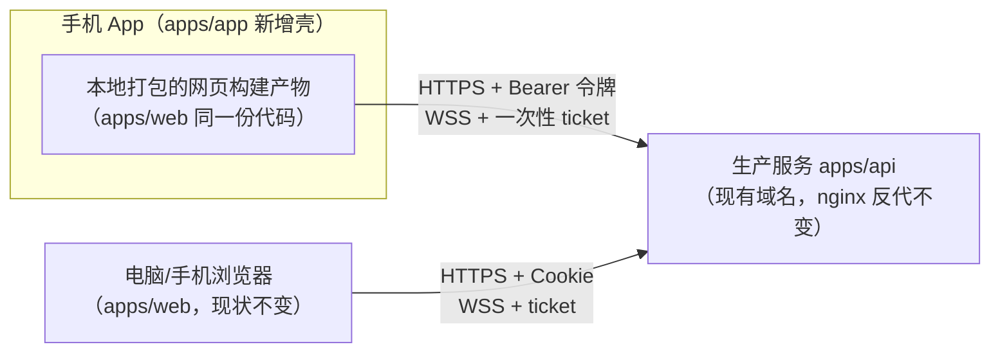

# 13 — App 版本开发计划

状态：已拍板（决策记录见 §9）。M0 已完成（2026-10-17 模拟器验收），下一步 M1 认证与网络。
日期：2026-10-17；代码基线：dev `4e4b3ed`。

## 0. 结论

用 Capacitor 把现有网页装进原生外壳，做成 Android App，上架 Google Play。`apps/web` 的代码全部复用，新增一个壳工程 `apps/app`，再给网页加一层可开关的适配（接口基址、令牌登录、深链）。iOS 不做；大陆没有 Google Play 的用户继续用网页版，官网直装 APK 作为辅助渠道。

## 1. 目标与非目标

现状：玩家只能开浏览器、输网址玩。目标：手机上有个图标，点开即玩。

- App 功能与网页版完全一致：单人、多人房间、会客厅、邀请、创作、我的、登录
- 网页版照常存在、照常更新，两端共用同一份代码
- 邀请链接通吃：没装 App 的朋友点开照样是网页

非目标（第一版不做，以后再说）：

- 推送通知（「轮到你了」提醒）
- 微信登录、App 内支付（收费入口本来就关着；谷歌也要求数字商品走 Play 内购）
- 离线游玩、绕过商店的热更新
- iOS 版（已拍板不做）
- 微信小程序（PRD 01 就排除了首发）

## 2. 技术选型

| 路线 | 做法 | 工作量 | 结果 |
| --- | --- | --- | --- |
| **Capacitor（选它）** | 现有网页打进原生壳，App 内嵌浏览器内核（WebView）显示 | 天级 | 界面＝现在的手机网页，原生能力按需挂 |
| Expo（React Native）重写 | 全部页面用原生控件重写一遍 | 月级 | 手感更原生，等于重做一个客户端 |
| PWA | 网页加清单文件，浏览器里「添加到主屏」 | 小时级 | 国内浏览器基本不支持，iOS 会清数据，发不出安装包 |

选 Capacitor 的理由：

- `apps/web` 本来就按手机优先设计（44px 触控、16px 正文），装进壳里就是现在的手机体验
- SPEC §9（03-SPEC.md）当年预留的「App 复用 API、事件协议与类型契约」直接兑现
- 留了后路：以后若换 Expo 重写，服务端与契约层的改动全部保留，只有外壳层作废

代价：

- 界面本质是网页，滚动手感与纯原生 App 有差距
- WebView 与浏览器环境有差异，登录（跨站 Cookie 被 iOS 拦）和接口跨域要专门适配——这是本计划的主要工作量，见 §4

## 3. 整体架构

新增与改动一览：

| 位置 | 内容 | 性质 |
| --- | --- | --- |
| `apps/app`（新增） | Capacitor 8 壳工程：Android 平台代码、图标、启动屏、深链配置（包名 `cn.xiaobaozi.sp`，App 名「Jev 海龟汤」） | 新代码，量小 |
| `apps/web`（改造） | 适配层：接口/WS 基址可配、令牌登录、系统浏览器开外链、安全区 | 全部开关式，网页行为零变化 |
| `apps/api`（小改） | 允许的来源从单个改为列表；登录给 App 客户端发令牌；实时票据接受令牌 | 向后兼容 |
| `infra/`（小改） | nginx 加深链验证文件（`assetlinks.json`）的静态路由 | 静态文件 |
| 官网（新增） | App 下载页 + 隐私政策页 | 内容页 |

构建链：`apps/web build`（带 App 配置）→ `capacitor sync` 把产物拷进壳工程 → Android Studio 出安装包。开发时壳可以直接加载 Vite 开发服务器，改动即时热更新，迭代体验与现在一致。

## 4. 认证适配（核心改动）

现状（2026-10-17 摸底确认）：

- 网页登录靠 Cookie（Better Auth 的 HttpOnly 会话），`apps/web/src/api/client.ts:36` 所有请求 `credentials: 'include'`
- 服务端只信任一个来源：CORS 与 trustedOrigins 都只有 `PUBLIC_BASE_URL`（`auth.instance.ts:74`、`main.ts:53`）
- 实时连接鉴权：先 HTTP 拿 30 秒一次性 ticket，再开 WebSocket 发 auth 帧，WS 本身不依赖 Cookie
- 单人模式的匿名凭证放在请求体里、存 IndexedDB，与 Cookie 无关，App 里直接能用

问题：App 的网页从本地文件加载，来源是 `https://localhost`，调生产接口属于跨站请求；Android WebView 默认拒收第三方 Cookie（页面去请求别的域名时带的 Cookie），Cookie 方案在 App 里走不通。

方案（与 SPEC §9 的既定约束一致：原生端用令牌模式，网页 Cookie 只留给浏览器）：

1. **登录**：邮箱密码/验证码登录时，服务端对 App 客户端把会话令牌（一串身份凭据）直接放进响应体返回；网页登录照旧走 Cookie，两条路互不影响
2. **保存**：令牌存 App 本地存储（Capacitor Preferences）
3. **使用**：之后每个请求带 `Authorization: Bearer <令牌>` 头；Better Auth 官方有 bearer 插件，服务端注册后自动识别这种头
4. **实时**：拿 ticket 的那次 HTTP 同样带令牌头，WS 流程零改动
5. **OAuth（Google / LINUX DO）**：App 内用系统浏览器打开授权页，授权完跳回 App（见 §5）；登录返回地址的同源校验（`login-navigation.ts`）给 App 模式放行自己的回调地址

壳工程的 `androidScheme` 用默认值 `https`，页面来源固定是 `https://localhost`，服务端只需多放行这一个来源。

B 计划（令牌这条路在 better-auth 1.3.4 上若遇到实现阻力）：用 Capacitor 官方 CapacitorHttp，请求从原生层发出，原生层有自己的 Cookie 存储不受 ITP 限制。能用但不够干净，只在 A 计划受阻时启用。

服务端改动清单：

- `trustedOrigins` 与 CORS 从单来源改为环境变量列表（如 `APP_EXTRA_ORIGINS=https://localhost`）
- 登录链路给 App 客户端发令牌（挂载点——better-auth hooks 还是薄封装端点——M1 动手时定）
- realtime ticket 签发走 getSession，注册 bearer 插件后自动同时接受 Cookie 与令牌

M1 落地记录（2026-10-17）：

- **bearer 契约**（better-auth 实测 1.7.6）：注册 `bearer()` 插件即可，无独立令牌表、无刷新端点——登录/会话刷新响应经 `set-auth-token` 响应头把会话 Cookie 值原样下发（CORS expose 已放行），客户端之后带 `Authorization: Bearer <该值>`，插件在请求进门前把它换算回会话；会话刷新（updateAge）保留同一令牌，客户端无需续期逻辑
- **一处生效全站**：Nest 全部业务接口经 `session.guard` → `auth.api.getSession`，守卫透传完整请求头，bearer 插件在 getSession 内生效——rooms/creations/billing 等业务代码零改动
- **令牌存储**：WebView localStorage（`https://localhost` 私有空间）。计划原定 Capacitor Preferences，落地改用 localStorage：省掉给 apps/web 引入 Capacitor 依赖（包边界保持 contracts/i18n/ui 三件套），安全面等价（同为 App 私有存储）；壳检测靠 Capacitor 原生桥注入的 `window.Capacitor`
- **CORS 挂点**：`bootstrap.ts` 在 better-auth 路由挂载前手写 CORS 中间件（`cors` 包不在 apps/api 依赖里，约 25 行）。关键：`/api/v1/auth` 先于 Nest 注册，`nestApp.enableCors` 盖不到它——main.ts 的 enableCors 已删除，整站 CORS 统一在 express 层，同时盖住两者
- **网页零变化**：`VITE_API_BASE_URL` 未设置时基址为空 → 相对路径、无令牌头、localStorage 不读写；`isAppShell` 为 false 时适配层全部函数都是空操作

## 5. 深链与邀请

- 邀请链接形状不变：`https://<域名>/lobby/invite/<hex>`。没装 App 的人点开就是网页，天然兜底
- 装了 App 的手机：Android App Links（域名下放 `assetlinks.json` 证明 App 归属）点链接直接开 App 进房间
- App 内分享出去的链接仍是 https 网页链接，大家都能打开
- `assetlinks.json` 由现有 nginx 直接静态托管；里面要写签名证书指纹，所以 App Links 在 M3 拿到正式签名密钥后启用，M2 先用普通链接 + 剪贴板过渡

## 6. 打包、分发与合规（Google Play）

### 开发与打包

- 这台 Windows 机已具备 Node 24 与 JDK 21（2026-10-17 检查），还缺 Android SDK——装 Android Studio（自带 SDK 管理）即可，Capacitor 8 要求 JDK 21 正好满足
- 用 Capacitor 8（当前最新稳定版 8.5.x）：Google Play 自 2025 年 11 月起要求新提交的 App 支持 16 KB 内存页，Capacitor 8 已支持，更老的版本不行
- 签名：注册 Play 时默认启用 Play App Signing（谷歌保管正式密钥），本地只保管上传密钥（upload keystore），丢了可以重置，风险低
- 本机构建网络两坑（2026-10-17 已解决，细节在 AGENTS.md 踩坑点）：命令行 Gradle 直连 dl.google.com 的 TLS 握手被重置，AGP 拉不下来，阿里云 maven 镜像已注入 `apps/app/android/build.gradle`；platform / build-tools 没有 maven 通道、自动安装同样被墙，版本对齐本机已装组件（compileSdk 37 / buildTools 36.0.0）

### Google Play 上架流程（M4）

- 注册 Play 开发者账号：一次性 25 美元，个人账号即可
- 新个人账号有冷启动要求：先跑封闭测试（closed testing），至少 12 名测试者连续 14 天装着并用，之后才能申请正式发布（官方现行口径，2026-10 查证；原始要求 20 人，后来降到 12）。测试者要有 Google 账号，得提前攒人
- 内部测试轨道（internal testing）没有人数/天数门槛，自己随时装，先用它做日常真机分发
- 资料填报：数据安全表单（收集邮箱、HTTPS 传输）、内容分级问卷（IARC，按游戏/问答类作答）、隐私政策链接（必填）、目标受众年龄
- AI 内容政策：Play 对带生成式 AI 功能的 App 要求提供应用内举报/屏蔽入口，并在 Console 里申报 AI 功能——站内已有举报（governance）体系，M4 前核对覆盖面是否够
- 每年跟进 targetSdk 要求（Google 要求 target API level 落后最新 Android 不超过一年），跟 Capacitor 大版本升级走

### 大陆用户与辅助渠道

- 大陆没有 Google Play：大陆用户继续用网页版；官网 APK 直装页保留作辅助渠道（Google 不排斥免费 App 多渠道分发）
- 国内手机商店（华为/小米/OV）要软著（软件著作权登记证书）+ 多数要企业主体，个人走不通，不做

### 支付与隐私

- App 第一版不带任何付费/赞助入口（收费本来就未开通）。将来若在 App 内卖会员，谷歌要求走 Play 内购（抽成 15% 起），到时单独决策
- 隐私政策：官网补一页中文隐私政策（本站只收集邮箱，好写），Play 必填
- App 权限最小化：第一版只要联网权限，不要相机/定位/通讯录

## 7. 里程碑

| 阶段 | 内容 | 验收标准 | 量级 |
| --- | --- | --- | --- |
| M0 骨架 | 装 Android Studio + JDK；建 `apps/app` 壳工程；模拟器加载 Vite 开发服务器 | 模拟器能浏览题库、玩单人 | 约 1 天 |
| M1 认证与网络 | 接口/WS 基址可配；令牌登录全链路；服务端来源列表 + bearer | 真机登录、进房间提问、断网重连补齐全通 | 2–3 天 |
| M2 深链与回归 | OAuth 系统浏览器回流；邀请链接打开 App；键盘避让/安全区细节；全功能回归 | 两台真机互发邀请对局 | 2–3 天 |
| M3 Android 交付 | 签名（Play App Signing + 本地上传密钥）、图标、启动屏、App Links 验证文件、官网下载页、隐私政策 | 官网下载 APK 装机可玩 | 1–2 天 |
| M4 Google Play 上架 | 注册账号（25 美元）、内部测试轨道先行、资料填报、攒 12 名测试者跑满 14 天封闭测试、申请正式发布 | Play 可搜索、可安装 | 1–2 天 + 14 天冷启动与审核 |

M0 完成记录（2026-10-17）：壳工程编译出 debug APK（4.3 MB），模拟器安装启动，首页与导航渲染正常、无崩溃。「浏览题库、玩单人」依赖接口连通（基址适配），随 M1 一起验收；「模拟器加载 Vite 开发服务器」是开发期热更新手段，M1 联调时再启用。

M1 完成记录（2026-10-17，代码落地、待真机验收）：方案与契约见 §4 落地记录。改动清单——服务端 `env.ts`（APP_EXTRA_ORIGINS 校验 + allowedOrigins）、`bootstrap.ts`（express 层 CORS 中间件）、`main.ts`（删 enableCors）、`auth.instance.ts`（bearer 插件 + trustedOrigins 列表）；web 新增 `src/app-runtime.ts` 适配层与 `.env.app`（App 构建的接口基址），`client.ts` / `auth-client.ts` / 两个实时 sync hook / `otp-cooldown.ts` 接线，`pnpm build:app` 产出带生产基址的构建。真机验收要点：登录（密码 + 验证码）、进房间提问、断网重连补齐。

每阶段收尾跑 `pnpm typecheck` + `pnpm test`；网页端用现有 e2e 保障（App 适配全部开关式，网页默认路径不变）。

后续阶段（另行决策）：推送通知、微信登录。

## 8. 风险

| 风险 | 应对 |
| --- | --- |
| Play 新账号封闭测试冷启动（12 人 × 14 天），审核还看测试者活跃度 | 提前攒人（朋友 + 社群），期间用内部测试轨道持续迭代 |
| Play 对 AI 生成内容类 App 的审核（应用内举报入口、AI 功能申报） | 站内已有举报体系，M4 前核对是否覆盖 AI 判题与聊天内容 |
| better-auth 1.3.4 令牌签发的实现细节 | M1 第一件事做技术验证；受阻则启用 CapacitorHttp B 计划 |
| 国产安卓系统杀后台、断长连接 | 已有指数退避重连 + seq 补齐，App 前台场景风险低 |
| 一套代码两端维护 | 改动集中在适配层，App 专属代码只有壳工程 |

## 9. 决策记录（2026-10-17 用户拍板）

1. 技术路线：Capacitor
2. 平台范围：只做 Android，iOS 不做
3. 分发：上架 Google Play；大陆用户走网页，官网 APK 直装作辅助渠道
4. 包名：`cn.xiaobaozi.sp`（上架后不可改）
5. App 名称：Jev 海龟汤
6. PWA manifest：跳过
