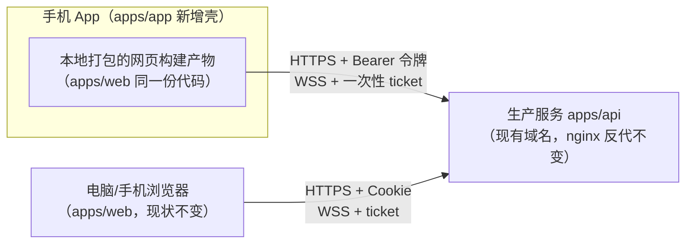

# 13 — App 版本开发计划

状态：草案，等第 9 节决策清单确认后开工。
日期：2026-10-17；代码基线：dev `4e4b3ed`。

## 0. 结论

用 Capacitor 把现有网页装进原生外壳，做成可安装的 Android / iOS App。`apps/web` 的代码全部复用，新增一个壳工程 `apps/app`，再给网页加一层可开关的适配（接口基址、令牌登录、深链）。先做 Android、官网直接下安装包；iOS 涉及开发者账号与中国区上架政策，放在后面按决策推进。

## 1. 目标与非目标

现状：玩家只能开浏览器、输网址玩。目标：手机上有个图标，点开即玩。

- App 功能与网页版完全一致：单人、多人房间、会客厅、邀请、创作、我的、登录
- 网页版照常存在、照常更新，两端共用同一份代码
- 邀请链接通吃：没装 App 的朋友点开照样是网页

非目标（第一版不做，以后再说）：

- 推送通知（「轮到你了」提醒）
- 微信登录、App 内支付（收费入口本来就关着；苹果也禁止数字商品跳站外支付）
- 离线游玩、绕过商店的热更新
- 微信小程序（PRD 01 就排除了首发）

## 2. 技术选型

| 路线 | 做法 | 工作量 | 结果 |
| --- | --- | --- | --- |
| **Capacitor（选它）** | 现有网页打进原生壳，App 内嵌浏览器内核（WebView）显示 | 天级 | 界面＝现在的手机网页，原生能力按需挂 |
| Expo（React Native）重写 | 全部页面用原生控件重写一遍 | 月级 | 手感更原生，等于重做一个客户端 |
| PWA | 网页加清单文件，浏览器里「添加到主屏」 | 小时级 | 国内浏览器基本不支持，iOS 会清数据，发不出安装包 |

选 Capacitor 的理由：

- `apps/web` 本来就按手机优先设计（44px 触控、16px 正文），装进壳里就是现在的手机体验
- SPEC §9（03-SPEC.md）当年预留的「App 复用 API、事件协议与类型契约」直接兑现
- 留了后路：以后若换 Expo 重写，服务端与契约层的改动全部保留，只有外壳层作废

代价：

- 界面本质是网页，滚动手感与纯原生 App 有差距
- WebView 与浏览器环境有差异，登录（跨站 Cookie 被 iOS 拦）和接口跨域要专门适配——这是本计划的主要工作量，见 §4

## 3. 整体架构

新增与改动一览：

| 位置 | 内容 | 性质 |
| --- | --- | --- |
| `apps/app`（新增） | Capacitor 壳工程：Android/iOS 平台代码、图标、启动屏、深链配置 | 新代码，量小 |
| `apps/web`（改造） | 适配层：接口/WS 基址可配、令牌登录、系统浏览器开外链、安全区 | 全部开关式，网页行为零变化 |
| `apps/api`（小改） | 允许的来源从单个改为列表；登录给 App 客户端发令牌；实时票据接受令牌 | 向后兼容 |
| `infra/`（小改） | nginx 加两个深链验证文件的静态路由 | 静态文件 |
| 官网（新增） | App 下载页 + 隐私政策页 | 内容页 |

构建链：`apps/web build`（带 App 配置）→ `capacitor sync` 把产物拷进壳工程 → Android Studio 出安装包。开发时壳可以直接加载 Vite 开发服务器，改动即时热更新，迭代体验与现在一致。

## 4. 认证适配（核心改动）

现状（2026-10-17 摸底确认）：

- 网页登录靠 Cookie（Better Auth 的 HttpOnly 会话），`apps/web/src/api/client.ts:36` 所有请求 `credentials: 'include'`
- 服务端只信任一个来源：CORS 与 trustedOrigins 都只有 `PUBLIC_BASE_URL`（`auth.instance.ts:74`、`main.ts:53`）
- 实时连接鉴权：先 HTTP 拿 30 秒一次性 ticket，再开 WebSocket 发 auth 帧，WS 本身不依赖 Cookie
- 单人模式的匿名凭证放在请求体里、存 IndexedDB，与 Cookie 无关，App 里直接能用

问题：App 的网页从本地文件加载，来源是 `https://localhost`，调生产接口属于跨站请求；iOS 的 WKWebView 有 ITP（智能防跟踪）机制，会拦跨站 Cookie。Cookie 方案在 App 里走不通。

方案（与 SPEC §9 的既定约束一致：原生端用令牌模式，网页 Cookie 只留给浏览器）：

1. **登录**：邮箱密码/验证码登录时，服务端对 App 客户端把会话令牌（一串身份凭据）直接放进响应体返回；网页登录照旧走 Cookie，两条路互不影响
2. **保存**：令牌存 App 本地存储（Capacitor Preferences）
3. **使用**：之后每个请求带 `Authorization: Bearer <令牌>` 头；Better Auth 官方有 bearer 插件，服务端注册后自动识别这种头
4. **实时**：拿 ticket 的那次 HTTP 同样带令牌头，WS 流程零改动
5. **OAuth（Google / LINUX DO）**：App 内用系统浏览器打开授权页，授权完跳回 App（见 §5）；登录返回地址的同源校验（`login-navigation.ts`）给 App 模式放行自己的回调地址

壳工程统一配 `androidScheme: https`，让 Android/iOS 的页面来源都是 `https://localhost`，服务端只需多放行这一个来源。

B 计划（令牌这条路在 better-auth 1.3.4 上若遇到实现阻力）：用 Capacitor 官方 CapacitorHttp，请求从原生层发出，原生层有自己的 Cookie 存储不受 ITP 限制。能用但不够干净，只在 A 计划受阻时启用。

服务端改动清单：

- `trustedOrigins` 与 CORS 从单来源改为环境变量列表（如 `APP_EXTRA_ORIGINS=https://localhost`）
- 登录链路给 App 客户端发令牌（挂载点——better-auth hooks 还是薄封装端点——M1 动手时定）
- realtime ticket 签发走 getSession，注册 bearer 插件后自动同时接受 Cookie 与令牌

## 5. 深链与邀请

- 邀请链接形状不变：`https://<域名>/lobby/invite/<hex>`。没装 App 的人点开就是网页，天然兜底
- 装了 App 的手机：Android App Links（域名下放 `assetlinks.json` 证明 App 归属）点链接直接开 App 进房间；iOS 的 Universal Links 同理（放 `apple-app-site-association`，需要苹果开发者账号），放 M4
- App 内分享出去的链接仍是 https 网页链接，大家都能打开
- 两个验证文件由现有 nginx 直接静态托管；`assetlinks.json` 里要写签名证书指纹，所以 App Links 在 M3 拿到正式签名密钥后启用，M2 先用普通链接 + 剪贴板过渡

## 6. 打包、分发与合规

这一节是现实阻力最大的部分，先看清再花钱。

开发机限制：

- 这台 Windows 机装 Android Studio + JDK 后能直接出 Android 包
- iOS 打包必须 macOS：用 GitHub Actions 的 macOS 云构建（免费额度每月 2000 分钟，够用）；签名与上传 TestFlight 需要苹果开发者账号（688 元/年）

Android 分发：

- 国内手机商店（华为/小米/OV）上架要软著（软件著作权登记证书），多数还要企业主体，个人走不通——第一版不上商店
- 第一版：官网放 APK 安装包直接下载 + 一页安装说明。国产手机装「来路不明」的包会弹风险提示，一次性的，可以接受
- 必备资产：签名密钥（keystore 文件，生成后离线保存，丢了老用户就无法覆盖升级）、多尺寸图标（现只有 icon.svg，需出 PNG 各尺寸）、启动屏

iOS 分发（M4，看决策）：

- 版号风险：中国区 App Store 对「游戏」类 App 要游戏版号（游戏出版备案，个人申请不到）。本产品是 AI 主持的文字推理，存在被归入游戏的风险；按「社交/桌游助手」类目定位有机会，没有保证
- 稳妥路径：先 TestFlight（苹果官方内测渠道）+ 海外区 App Store；中国区正式上架等条件成熟再评估
- 苹果对「网页套壳」有最低功能要求（4.2 条款）：本产品有完整玩法与实时多人，达标没有悬念

支付与隐私：

- App 第一版不带任何付费/赞助入口（收费本来就未开通）；赞助留在网页。将来微信商户开通后，Android 可引导去网页支付，iOS 需单独议
- 上架需要隐私政策链接：官网补一页中文隐私政策（本站只收集邮箱，好写）
- App 权限最小化：第一版只要联网权限，不要相机/定位/通讯录

## 7. 里程碑

| 阶段 | 内容 | 验收标准 | 量级 |
| --- | --- | --- | --- |
| M0 骨架 | 装 Android Studio + JDK；建 `apps/app` 壳工程；模拟器加载 Vite 开发服务器 | 模拟器能浏览题库、玩单人 | 约 1 天 |
| M1 认证与网络 | 接口/WS 基址可配；令牌登录全链路；服务端来源列表 + bearer | 真机登录、进房间提问、断网重连补齐全通 | 2–3 天 |
| M2 深链与回归 | OAuth 系统浏览器回流；邀请链接打开 App；键盘避让/安全区细节；全功能回归 | 两台真机互发邀请对局 | 2–3 天 |
| M3 Android 交付 | 签名、图标、启动屏、App Links 验证文件、官网下载页、隐私政策 | 官网下载 APK 装机可玩 | 1–2 天 |
| M4 iOS（决策后） | 苹果账号、Universal Links、云构建、TestFlight | TestFlight 装机可玩 | 2–3 天 + 等审核 |
| M5 商店化（决策后） | 软著/版号/主体评估，国内安卓商店与 App Store 中国区 | 视外部流程 | 外部流程为主 |

每阶段收尾跑 `pnpm typecheck` + `pnpm test`；网页端用现有 e2e 保障（App 适配全部开关式，网页默认路径不变）。

## 8. 风险

| 风险 | 应对 |
| --- | --- |
| 苹果中国区把产品判为游戏、要版号 | iOS 投入放在 Android 跑通之后；先 TestFlight / 海外区 |
| better-auth 1.3.4 令牌签发的实现细节 | M1 第一件事做技术验证；受阻则启用 CapacitorHttp B 计划 |
| 国产安卓系统杀后台、断长连接 | 已有指数退避重连 + seq 补齐，App 前台场景风险低 |
| 一套代码两端维护 | 改动集中在适配层，App 专属代码只有壳工程 |

## 9. 待拍板的决策清单

只列定了不好改、或要花钱的项：

1. 技术路线按 Capacitor 走？（推荐，理由见 §2）
2. 先 Android（官网发 APK）、iOS 后置？（推荐；并行也行，但要提前买苹果账号 + 配云构建）
3. 苹果开发者账号 688 元/年：现在买，还是 Android 跑通再说？（M4 开工前买即可）
4. App 名称与包名：名称沿用「AI 海龟汤」；包名建议 `cn.xiaobaozi.jevturtlesoup`（包名上架后改不了，确认一下）
5. 要不要顺手补 PWA manifest（对国内用户价值很小，建议跳过）
