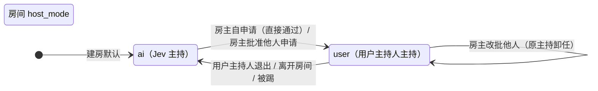
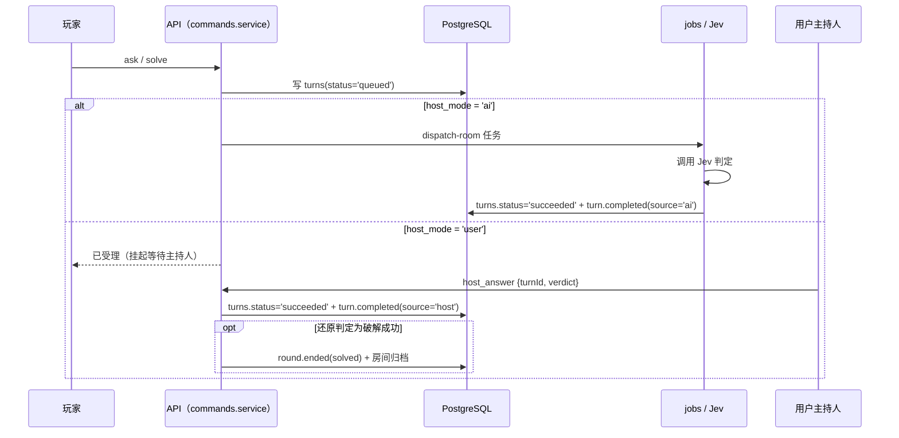

# 用户主持人模式（房主之外的第二主持）

版本：2026-10-20。背景：多人房间此前只有一种主持——AI「Jev」。用户希望自己也能当主持人，亲自回答玩家的问题、掌握汤底、按需给提示。本文是本功能的唯一规则源；实现与本文冲突时以本文为准。

## 一、产品规则

1. **两种角色并存，互不替代**：
   - **房主**（`rooms.host_user_id`，既有概念）：房间所有者，掌握管理权——邀请、踢人、解锁提示、公布答案、结束本局、解散房间、**审核主持人申请**。
   - **主持人**（本文件新增）：主持本局游戏的人，回答玩家提问、掌握汤底、给提示。默认由 AI「Jev」担任；任何房间成员都可以申请由自己接管。

2. **一个房间同一时刻至多一位用户主持人**。房主与用户主持人可以是同一个人（房主自己申请直接通过）。

3. **房间用参数标识主持人形态**：`rooms.host_mode ∈ {ai, user}`。
   - `ai`：Jev 主持。提问照旧进队列由 Jev 判定。
   - `user`：用户主持人主持。**玩家的提问不再进 AI 队列**，改为挂起等待用户主持人回答。

4. **会客厅与房间各自独立持有主持人状态**。会客厅（`user_lobbies`）里批准的会主持人，在 `start` 事务里迁移进新房；房间里也可以单独申请与审批。两处互不干扰（沿用 10 号文档「会客厅与房间生命周期解耦」的结论）。

5. **申请与审批**：
   - 房主自己申请 → **直接通过**（无需审批）。
   - 其他成员申请 → 生成待审申请，**房主收到提示**并选择批准或拒绝。
   - 房主可以随时改批：批准新人时，原用户主持人自动卸任（回到普通玩家身份），并收到卸任事件。

6. **房主可以撤销主持身份**：房主在玩家列表里对当前用户主持人点「撤销主持」，对方**降级为普通玩家**，本局立刻回到 Jev 主持（挂起的提问与还原交还 Jev）。主持人自己不能撤销自己——那条路是「退出主持人」。

7. **用户主持人可自行退出**，入口在**会客厅页**与**房间页右上角玩家列表**。退出后本局回到 `host_mode='ai'`，Jev 重新接管判定；退出的用户同时失去汤底查看权。

8. **退出/离开即卸任**：用户主持人离开房间、被房主踢出、会客厅解散或开局迁移结束，主持身份一并失效，房间回到 AI 模式。

9. **主持人的三个子页面形态**（底部「问 Jev / 还原真相 / 和大家讨论」按钮不变，子页面内容随身份变化）：
   - **问 Jev**：用户主持人看到的是**别人提出的问题**，每条问题底部有三个快捷按钮「是 / 否 / 无关」，点一下即完成对该问题的回答，答案对全房间可见。普通玩家在该页面仍是提问框。
   - **还原真相**：用户主持人视角下该页签改名为**「查看汤底」**，点开**直接展示当前汤底**（不弹确认框），同时列出**等待判定的还原提交**，每条底部有「破解成功 / 接近真相 / 还没猜对」三个快捷按钮；普通玩家仍是提交还原的输入框。
   - **和大家讨论**：用户主持人可以发任意消息，并且**能看到全房间其他人的讨论**——用于按需给提示。主持人的发言在列表里带「主持人」标记。

10. **汤底保密不破例**：汤底**不会**出现在快照、房间事件、讨论消息里。用户主持人查看汤底走**专用接口**，仅在「本房间 `host_mode='user'` 且调用者就是该房间的用户主持人」时返回。

11. **判题责任归属**：用户主持模式下，**玩家的提问与还原提交都挂起等待用户主持人判定**，Jev 完全不介入这两类提交：
    - `ask`（提问）：主持人在「问 Jev」页用「是 / 否 / 无关」快捷判定；
    - `solve`（还原）：主持人在「查看汤底」页用「破解成功 / 接近真相 / 还没猜对」快捷判定；判定为「破解成功」时本局立即结束并归档（一房一题）。
    - 判定值必须与提交类型匹配，跨类型使用直接被服务端拒绝（决策 D3）。

12. **计费不变量不变**：首次有效判定（无论来自 Jev 还是用户主持人）或公布答案时消费一次免费开房额度。

## 二、角色与状态模型



**字段分工**（房间）：

| 字段 | 位置 | 含义 | 权威性 |
| --- | --- | --- | --- |
| `host_mode` | `rooms` | 本房间当前是 AI 主持还是用户主持 | 权威（判题分支读它） |
| `user_host_id` | `rooms` | 当前用户主持人的 user_id（null = 无） | 权威（谁在主持） |
| `role` | `room_members` | 成员身份：`player` / `user_host` | 镜像（与 `user_host_id` 同事务写入，供成员列表渲染） |
| `host_requested_at` | `room_members` | 待审申请时间（非空 = 有申请在等房主） | 权威（申请状态） |

**字段分工**（会客厅）：`user_lobbies.host_mode`、`user_lobbies.user_host_id`、`lobby_members.role`、`lobby_members.host_requested_at`，语义同上。

**不变量**：

- I1：`rooms.host_mode='user'` ⟺ `rooms.user_host_id IS NOT NULL`。
- I2：一个房间至多一名成员 `role='user_host'`（部分唯一索引兜底）；会客厅同理。
- I3：`role='user_host'` 的成员一定同时出现在 `host_mode='user'` 的作用域里；反之 `user_host_id` 指向的用户若是成员行，则该行 `role='user_host'`（会客厅的房主没有座位行，此条对房主不适用）。
- I4：待审申请只可能出现在非房主成员上——房主自己申请直接通过，不产生申请。

## 三、数据模型落地

```sql
-- 0012_user_host_mode.sql
CREATE TYPE "host_mode" AS ENUM ('ai', 'user');
CREATE TYPE "room_member_role" AS ENUM ('player', 'user_host');

ALTER TABLE "rooms"
  ADD COLUMN "host_mode" "host_mode" NOT NULL DEFAULT 'ai',
  ADD COLUMN "user_host_id" text REFERENCES "user"("id") ON DELETE SET NULL;

ALTER TABLE "room_members"
  ADD COLUMN "role" "room_member_role" NOT NULL DEFAULT 'player',
  ADD COLUMN "host_requested_at" timestamp with time zone;

-- 不变量 I2：每个房间至多一名用户主持人
CREATE UNIQUE INDEX "room_members_one_user_host_uq"
  ON "room_members" ("room_id") WHERE "role" = 'user_host';

-- 判定来源：ai = Jev；host = 用户主持人
ALTER TABLE "turns" ADD COLUMN "judged_by" text;

ALTER TABLE "user_lobbies"
  ADD COLUMN "host_mode" "host_mode" NOT NULL DEFAULT 'ai',
  ADD COLUMN "user_host_id" text REFERENCES "user"("id") ON DELETE SET NULL;

ALTER TABLE "lobby_members"
  ADD COLUMN "role" "room_member_role" NOT NULL DEFAULT 'player',
  ADD COLUMN "host_requested_at" timestamp with time zone;

CREATE UNIQUE INDEX "lobby_members_one_user_host_uq"
  ON "lobby_members" ("lobby_id") WHERE "role" = 'user_host';
```

存量数据全部落在默认 `ai` + `player`，无需回填。

**`role` 与 `user_host_id` 的分工**：`user_host_id` 是权威指针（谁在主持），`role` 是同事务写入的镜像（成员列表直接渲染），部分唯一索引顺带兜住「一个作用域至多一名用户主持人」。`turns.judged_by` 记录判定来源，刷新快照后前端仍能区分这条判定来自 Jev 还是玩家。

## 四、契约

### 4.1 房间命令（`POST /rooms/:id/commands`）

| 命令 | 载荷 | 权限 | 效果 |
| --- | --- | --- | --- |
| `request_host` | `{}` | 房间成员 | 房主 → 直接通过；其他成员 → 生成待审申请（`host_requested_at`） |
| `approve_host` | `{userId}` | 仅房主 | 目标成员成为用户主持人；原主持卸任；`host_mode='user'` |
| `reject_host` | `{userId}` | 仅房主 | 清掉目标成员的待审申请 |
| `revoke_host` | `{userId}` | 仅房主 | 撤销目标成员已有的主持身份：降级为普通玩家，`host_mode='ai'`，挂起提交交还 Jev |
| `resign_host` | `{}` | 仅当前用户主持人 | 卸任，`host_mode='ai'`，挂起的提交交还 Jev |
| `host_answer` | `{turnId, verdict}` | 仅当前用户主持人 | 对挂起的提交给出判定：提问 `yes` / `no` / `irrelevant`；还原 `solved` / `close` / `not_yet` |

判定值与提交类型必须匹配：提问不能用还原的判定值，反之亦然，服务端直接以 `VALIDATION_FAILED` 拒绝。提问判定里**不含** `uncertain`：人类主持没有「无法确定」这个选项。还原判定为 `solved`（破解成功）时，本局立即结束并归档。

### 4.2 会客厅接口（`/lobbies/:id/host/*`）

会客厅不是房间，没有命令通道，用独立 HTTP 端点：

| 端点 | 载荷 | 权限 | 效果 |
| --- | --- | --- | --- |
| `POST /lobbies/:id/host/request` | — | 会客厅成员 | 同 `request_host` |
| `POST /lobbies/:id/host/approve` | `{userId}` | 仅会客厅房主 | 同 `approve_host` |
| `POST /lobbies/:id/host/reject` | `{userId}` | 仅会客厅房主 | 同 `reject_host` |
| `POST /lobbies/:id/host/revoke` | `{userId}` | 仅会客厅房主 | 同 `revoke_host` |
| `POST /lobbies/:id/host/resign` | — | 仅当前用户主持人 | 同 `resign_host` |

### 4.3 主持人汤底（保密）

`GET /rounds/:id/host-view` → `{answer, hints}`。

放行条件（三条同时成立）：该局属于某个房间；该房间 `host_mode='user'`；`rooms.user_host_id` 等于调用者 userId。任一不满足返回 `FORBIDDEN`。

**不进入**快照、房间事件、讨论 payload、房间历史。

### 4.4 房间事件

| 事件 | 载荷 |
| --- | --- |
| `room.host_requested` | `{userId, nickname}` |
| `room.host_approved` | `{userId, nickname, previousUserId}` |
| `room.host_rejected` | `{userId, nickname}` |
| `room.host_resigned` | `{userId, nickname}` |

`turn.completed` 增加可选字段 `source ∈ {ai, host}`，用于区分判定来源。

### 4.5 快照字段

- 房间快照新增：`hostMode`、`userHostId`；成员项新增 `isUserHost`；新增 `hostRequests: [{userId, nickname}]`（房主据此弹审核提示）；问答项新增 `source: 'ai' | 'host' | null`（判定来源）。
- 会客厅快照新增：`hostMode`、`userHostId`；成员项新增 `isUserHost`；新增 `hostRequests`。

## 五、判题链路

### 5.1 提问与还原（ask / solve）

提问与还原共用同一条链路：`ai` 模式交给 Jev，`user` 模式挂起等用户主持人判定。



### 5.2 jobs 侧改动

`dispatchRoom` 领取任务时，**`host_mode='user'` 的房间不领任何排队任务**（提问与还原都留给用户主持人）。挂起中的提交不参与 60 秒排队超时判定——挂起任务的 `deadline_at` 置 NULL，超时检查只对 `deadline_at IS NOT NULL` 的任务生效。

主持人退出、被房主撤销或房间回到 AI 模式时，API 在同一事务内向队列投递一次 `dispatch-room`，让挂起的提交重新由 Jev 处理。

### 5.3 判定来源与计费

用户主持人的回答与 Jev 的判定等价：都写 `turns.status='succeeded'`、都 `rounds.effective_verdicts + 1`、都消费一次免费开房额度（首个有效判定者消费）、都广播 `turn.completed`。主持判定「破解成功」额外走终局路径（局置 `solved`、全员标记已知答案、房间归档），与 Jev 判定破解成功一致。

## 六、前端交互

### 6.1 房间页

- **右上角玩家列表**：成员行显示身份徽标——「房主」（既有）与「主持人」（`isUserHost`）。
  - 我不是主持人、房间未进入用户主持模式 → 行内「申请成为主持人」按钮。
  - 我是房主且有成员待审 → 行内「批准 / 拒绝」按钮；收到 `room.host_requested` 事件时房主端弹审核提示。
  - 我是房主、对方是当前用户主持人 → 行内「撤销主持」按钮（降级为普通玩家）。
  - 我是当前用户主持人 → 行内「退出主持人」按钮。
- **问 Jev 子页**：
  - 用户主持人：看到其他人的提问，每条待答问题底部三个按钮「是 / 否 / 无关」，点击即提交 `host_answer`。
  - 其他角色：维持现状（自己的提问框 + 全房间问答流）。
- **还原真相子页**（用户主持人视角下页签改名为「查看汤底」）：
  - 用户主持人：直接展示汤底（来自 `/rounds/:id/host-view`），不弹确认框；页面上不额外显示提示文案。
  - 用户主持人：等待判定的还原提交底部三个按钮「破解成功 / 接近真相 / 还没猜对」，点击即提交 `host_answer`。
  - 其他角色：维持现状（页签名仍是「还原真相」，提交还原的输入框）。
- **和大家讨论子页**：主持人可发任意消息，并看到全房间讨论；主持人的发言带「主持人」标记。

### 6.2 会客厅页

成员列表与房间页一致：房主可批准/拒绝/撤销申请，成员可申请，主持人可退出。房主的审核提示通过会客厅 2 秒轮询快照里的 `hostRequests` 呈现（会客厅没有房间事件流）。

### 6.3 会客厅 → 房间迁移

`start` 事务内：`user_lobbies.host_mode='user'` 时，新房 `rooms.host_mode='user'`、`rooms.user_host_id` 取会客厅的用户主持人，对应 `room_members.role='user_host'`。

## 七、边界与失败处理

| 场景 | 处理 |
| --- | --- |
| 房主同时是用户主持人，又批准别人 | 房主自动卸任（原 `role` 回 `player`、`user_host_id` 切换），原主持收到 `room.host_approved`（`previousUserId` 指向自己） |
| 用户主持人离开房间 / 被踢 | 同一事务卸任并把 `host_mode` 回落 `ai`，挂起提问交还 Jev |
| 用户主持人在等待室退出 | `user_lobbies.user_host_id` 置空，`host_mode='ai'` |
| 会客厅开局时无有效会主持人 | 新房按 `ai` 模式开（主持人状态不迁移） |
| 用户主持人长时间不回答 | 提问保持挂起（不超时失败），玩家受「每人一个未完成提交」限制无法继续提问——与 AI 模式下的排队语义一致 |
| 用户主持人离线 | 与 AI 不可达同构：提问挂起不失败，房间不自动归档 |
| 房主离线 | 待审申请保留，房主回来后仍可审核 |
| 主持人改判已判定的问题 | 不支持：判定完成后不可再改（`turn.completed` 幂等语义） |
| 房间归档（一房一题） | 主持人状态随房间归档失效，不影响新房 |

## 八、决策记录

- **D1｜房主与主持人分离**。房主是资源所有者（邀请、踢人、公布答案），主持人是游戏主持人（回答提问、掌汤底）。两者权限不互相覆盖，避免「房主既是裁判又是裁判」的歧义。
- **D2｜申请需房主审批，房主自申请直接通过**。主持人掌握汤底，若人人可自封主持人，任何玩家都能看到汤底并自行宣布破解——审批是必要的闸门；房主自申请不设闸门，因为房主本来就有「公布答案」的权限。
- **D3｜还原真相（solve）也交给用户主持人判定**。初版只把提问交给主持人（还原仍由 Jev 判定），因为当时只设计了「是/否/无关」三个按钮；后续补齐了还原侧的「破解成功 / 接近真相 / 还没猜对」，还原同样挂起等主持人判定，判定为「破解成功」即终局归档。判定值按提交类型分流，跨类型使用被服务端拒绝。
- **D4｜用户主持人的回答置信度记为 1**。人类主持没有概率输出；`confidence='1'` 只影响展示（显示 100%），不影响判定逻辑。
- **D5｜挂起任务不参与排队超时**。挂起不是排队失败；超时判定只对 Jev 队列里的任务生效，避免用户主持稍慢就被判失败。
- **D6｜主持人汤底走独立接口**。保持「快照/事件不含汤底」的既有不变量（见 AGENTS.md 关键约定），只在服务端鉴权后单独下发。
- **D7｜会客厅主持人状态随 start 迁移**。会客厅是组队阶段，主持权在开局前就该定；迁移在 start 单事务内完成，不新增跨作用域耦合。
- **D8｜房主可撤销他人主持身份**。房主是资源的责任人，主持权不该只能由主持人自己交还；撤销与自行退出发同一个卸任路径（降级为玩家、房间回到 Jev 主持、挂起提交交还 Jev）。

## 九、验证

### 9.1 已完成

| 层次 | 载体 | 覆盖 |
| --- | --- | --- |
| 领域规则 | `packages/domain/test/host-mode.test.ts` | 申请/审批/撤销/退出的权限判定、主持判定的前置条件与判定值分型 |
| 契约校验 | `apps/api/src/rooms/host-mode.contract.test.ts` | 六条主持人命令的类型与载荷、四个主持事件 payload、房间/会客厅快照的新字段 |
| 访问控制 | `apps/api/src/billing/public-routes.test.ts` | 主持人汤底与五个会客厅主持端点必须带会话（不得公开/匿名） |
| 前端渲染 | `apps/web/test/room-host-mode.test.tsx` | 成员列表的主持人徽标与入口（含撤销）、事件应用（批准/卸任）、两套快捷判定按钮 |
| 真实数据库 | `apps/api/src/rooms/host-mode.integration.test.ts`（需 `HOST_MODE_TEST_DATABASE_URL`） | 迁移 0012 干净落地；申请 → 审批 → 提问挂起（不进队列）→ 主持人判定 → 汤底可见性 → 撤销/重批 → 退出回落 → 还原挂起与破解终局 → 会客厅开局迁移 |
| 端到端 | `scripts/e2e-host-mode.mjs` + `scripts/e2e-node-run.mjs`（`pnpm e2e:host`） | 真实 API + jobs + PostgreSQL + WebSocket + SMTP 收信台：含一次真实 Jev 调用 |

端到端剧本的关键断言：提问与还原挂起时 `turns.status='queued'` 且 `jev_calls` 无记录（证明 Jev 未被调用）；挂起任务 `deadline_at IS NULL`（不参与排队超时）；主持人判定落库 `judged_by='host'` 并广播 `turn.completed`；跨类型的判定值被拒；普通玩家读 `/rounds/:id/host-view` 返回 403 且快照不含汤底；房主撤销主持身份后对方降级为玩家、房间回到 `host_mode='ai'`；主持人退出后挂起的提交被 jobs 领走并由 Jev 判定（`judged_by='ai'`）；主持判定还原为「破解成功」时本局结束并归档、参与者可读汤底；房主自申请直接通过。

### 9.2 未覆盖 / 后续

- 用户主持模式下的「还原真相」仍由 Jev 判定（决策 D3），主持人在该子页面只看汤底与玩家提交，未实现人工判定还原。
- 多人同时申请主持人、主持人掉线时的接管策略目前只有「单一主持人 + 房主改批」这一种。
- 浏览器人工实测未做（自动化覆盖了接口、事件、判题链路与前端渲染）。

## 十、相关文档

- [10-ROOM-LIFECYCLE-REVISION.md](10-ROOM-LIFECYCLE-REVISION.md)：会客厅与房间解耦、一房一题、归档路径。
- [04-ROOM-JEV.md](04-ROOM-JEV.md)：提问/还原协议、排队、事件补齐。
- [12-CONNECTION-EXPERIENCE.md](12-CONNECTION-EXPERIENCE.md)：事件按 seq 应用、断线补齐。
- [16-CONCURRENCY-LIMITS.md](16-CONCURRENCY-LIMITS.md)：限流清单（本功能新增接口沿用既有闸门）。
