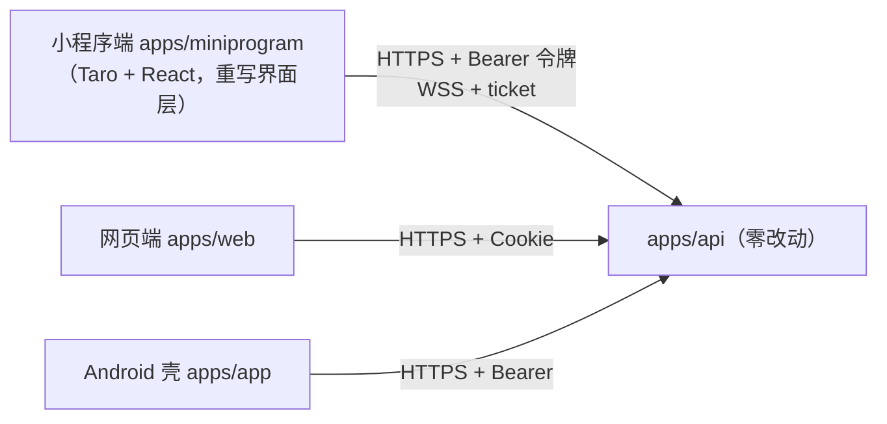

# 20 — 微信小程序版本计划

状态：已拍板（决策记录见 §8）。M0、M1、M2 完成（2026-10-25），M3 待做。
日期：2026-10-25；基线：feat/app-version（含 M3 Android 交付）。

## M2.7 完成记录（2026-10-31 / 11-05：修复预览报错 Invalid token / Unexpected token）

微信开发者工具「预览」对 dist 里没做语法降级的 **ES2021/ES2022 新语法** 报
SyntaxError，分两轮修完（配置都在 `apps/miniprogram/config/index.ts`）：

**第一轮（私有字段 `#field`，报 Invalid token）**，来源两批修法不同：

- **`.js` 来源**（@tanstack/react-query、query-core）：`compile.include` 圈进
  Taro 的 babel 即可，这条早就生效。
- **`.mjs` 来源**（better-call 的 `error.mjs`、@better-auth/core 的 `env-impl.mjs`）：
  `compile.include` 的脚本规则对 `.mjs` 实测不生效。另挂 webpackChain 的 babel 规则
  （`legacy-syntax-mjs`），并且 **babel-loader 必须显式传
  `{ cwd: appDir, configFile: <应用>/babel.config.js }`**——不带 options 时
  babel-loader 按「被编译文件」的位置向上找配置，`.pnpm` 深处的文件找不到应用的
  babel.config.js，等于零预设空转、原样输出（这是本次卡最久的一步：构建日志看着
  在编译、产物里 `#field` 纹丝不动）。

**第二轮（逻辑赋值 `||=`，报 Unexpected token =）**：修完第一轮预览换了报错
位置，定位到 **nanostores**（Taro 的传递依赖，`globalThis.nanostoresGlobal ||=`
一处）——微信预览器对 ES2021 逻辑赋值同样不认。nanostores 是 .js，加进
`legacySyntaxPaths`（从 @tarojs/taro 的目录解析）走 `compile.include` 即解决。

**第三轮（编译过了，运行时浏览器全局缺失连环炸）**：语法清零后代码第一次
真正跑起来，先后报 `Request is not defined` → `fetch is not defined`，全部出自
better-auth 初始化链（`dist/client/config.mjs`：`"credentials" in
Request.prototype` 特性检测 + `customFetchImpl: fetch` 对象字面量求值）。用 AST
作用域分析把 dist 全量扫了一遍，真正会炸的浏览器全局共 **5 个**，统一在新增的
`src/polyfills.ts` 补齐（app.tsx 首行 + auth-client.ts 双保险 import，先于一切
使用方执行；已有原生实现的环境不覆盖）：

- `fetch` → 补真实现（taroFetch 本来就是 fetch 形状，走 Taro.request）；
- `Request` / `Headers` / `Response` → 补空壳类。库只拿它们做能力检测与
  instanceof 分支，空壳让 instanceof 安全落到「鸭子类型」分支，实际行为由
  taroFetch 保证；
- `AbortController` → react-query 观察器构造时 `new` 它做查询取消，补最小
  实现（signal 状态 + abort 监听）。真机上必炸（开发者工具的 Chromium 内核有、
  真机运行时没有），属于「工具里正常、真机炸」的典型差异。

其余被扫出的名字（performance/setImmediate/MessageChannel/window/process/
Deno/Bun/localStorage/btoa 等）各有 `typeof` 守卫、try/catch 或分支不执行，
确认安全。**扫描器已升级为双检查**（`scripts/scan-weapp-syntax.mjs`）：①语法
四类；②未声明全局引用（作用域分析 + JS 内建/微信宿主白名单 + typeof 守卫识别
+ 应用 polyfill 登记），`build:mp` 后跑一次，两类均 0 通过——加新依赖后必跑，
能把「预览逐个报错」的循环掐死在构建后。

排查与验证工具沉淀为 **`scripts/scan-weapp-syntax.mjs`**：`build:mp` 之后跑，
用 @babel/parser 解析 dist 全部 js、AST 级找出四类微信不认的节点（class 公有/
私有字段、私有方法、静态块、逻辑赋值），0 处通过。比等预览逐个报错快得多，
新加依赖后建议跑一次。排查方法论也记一笔：看报错位置的真实代码片段归因来源包
（别信打包时的第一直觉，第一轮真凶 better-call、第二轮 nanostores 都与最初
怀疑对象不同）；pnpm 真实路径带哈希没法写死，`legacySyntaxPaths` 在配置加载时
动态解析（包 exports 不暴露 `./package.json` 时要解析主入口后向上找包根）。

## M2.6 完成记录（2026-10-27：登录换微信一键登录）

登录方式整体切换：**去掉邮箱登录/注册/找回密码，小程序端只留微信一键登录**
（web/App 端不受影响，邮箱通道照旧）。

- **后端**（`apps/api/src/auth/wechat-mini.ts`）：better-auth 自定义插件，
  端点 `POST /api/v1/auth/wechat-mini/login`。服务端直连
  `api.weixin.qq.com/sns/jscode2session`（AppSecret 只在服务端；境内服务器无需中继）
  换 openid → 按 `(providerId='wechat-mini', accountId=openid)` 找账号，没有就
  `createOAuthUser` 建号（占位邮箱 `wx-<openid>@wechat.invalid` 沿用 LINUX DO 的
  `*.invalid` 约定；昵称走注册钩子默认「用户+随机编号」；注册礼/免费账户/赞助账户
  钩子照常生效）→ `createSession` 后令牌放**响应体**（小程序无 Cookie，与 App 壳
  Bearer 链路同约定，客户端 `storeBearerToken` 直存）。并发双击撞唯一索引时重查兜底。
  `session_key` 不落库（本站不解密微信侧数据）；`unionid` 暂不存（站内只有小程序一个
  微信入口，openid 已唯一；接公众号/网站微信登录时再引入列做跨端合并）。
  凭据 `WECHAT_MINI_APPID` + `WECHAT_MINI_SECRET` 两项配齐才注册插件，缺一项端点不存在。
  频控吃 better-auth 全局默认（20 次/分钟/IP）。微信错误码映射：40029/40126 →
  `WECHAT_LOGIN_FAILED`（code 无效/已用，让用户重走 wx.login）、45011/-1 →
  `WECHAT_LOGIN_BUSY`（微信侧限流/繁忙）。
- **小程序端**：登录页重写为单按钮（`Taro.login()` → 插件端点 → 存令牌 →
  finishLogin），登录卡片下方留隐私政策入口（提审友好）；删除邮箱登录/注册/找回密码
  页与 OTP 倒计时模块（`pages/forgot-password`、`auth/otp-cooldown.ts`）；
  `authClient`（better-auth vanilla 客户端）保留——会话读取/刷新/登出仍走它。
  「我的」页邮箱展示脱敏：占位邮箱显示为「微信账号」。
- **账号体系口径**：微信登录建的是独立账号，与 web 邮箱账号互不相通（原「邮箱登录
  天然同步」路径随邮箱登录一起移除）；跨端权益同步靠兑换码（全端保留）。将来要打通
  时在设置页加「绑定邮箱」即可（account 表多 provider 天然支持）。
- 验证：全仓 typecheck 全绿、`build:weapp` 成功、`parseCode2Session` 单测 4 项通过
  （`apps/api/src/auth/wechat-mini.test.ts`）。真实链路待 AppID/AppSecret 配置后联调。

## M2.5 完成记录（2026-10-24 补充：奖励入口）

变现方式修订（21 号文档）落在小程序侧的部分：

- **邀请好友**：「我的」页邀请卡（邀请码 + 已邀人数 + 复制网页链接 + `openType="share"`
  转发按钮）；首页与我的页注册 `useInviteShare`（`src/invite/share.ts`），分享路径带
  `?ref=<邀请码>`；好友从分享进站 → 首页捕获 ref 存 Taro storage（页面参数与启动参数
  双来源）→ 登录后静默 `POST /invites/claim`（奖励 +5 发给邀请人）
- **看广告 +2 次**：「我的」页额度卡下方（非会员且非内测期显示），`src/ads/rewarded-ad.ts`
  完整实现意图令牌 → 激励视频 → 服务端验证回调入账链路；`AD_UNIT_ID` 占位为空，
  流量主开通（UV ≥ 1000）后填入即生效，开通前点击提示「广告通道开通中」
- **内测期徽标**：`/me` 返回 `betaOpen` 时额度卡显示「内测畅玩中」（替代具体数字）
- 坑：Taro 应用入口 `app.tsx` 经 webpack 特殊编译，从它导入值会丢
 （ModuleDependencyWarning）——全局 queryClient 放独立模块 `src/state/query-client.ts`

## M2 完成记录（2026-10-25：题库与单人）

- **题库页**：筛选（排序/难度/类别胶囊）+ 分页（上一页/页码/下一页）+ 已玩标记 + 署名与赞踩计数 + 单人开局入口；URL 参数换组件 state，翻页 keepPreviousData 平滑过渡（与 web 同款 react-query 配置）
- **单人游玩全流程**：开局（POST /solo/sessions 匿名凭证）→ 提问（带最近 10 轮已判定问答，供判题解析代词）→ 是/否/无关/无法确定判定徽标 + 置信度 → 还原（可开大模型 MiniMax 补判）→ 提示胶囊（3 条翻阅）→ 公布汤底（showModal 二次确认）→ 解出结算 / 揭晓面板 → 换题（游标翻全库随机抽未玩题，redirectTo 不堆栈）；退出重进按题目+语言恢复本地对局与输入草稿
- **本地存储**：`src/solo/local-store.ts` 的 soloStore 与 web 同名同形接口，IndexedDB 换 Taro storage KV 布局（会话/进度各一个 key、问答按会话分 key 存 JSON——单 key 1MB 上限内安全）；session-selection / unplayed-puzzle 纯函数逐字复用
- 游玩组件（TurnCard 问答气泡 / HintCapsule 提示胶囊 / LargeModelToggle 微信原生 Switch）抽在 `src/game/components.tsx`，后续多人房间直接复用
- **小程序差异**：题目评价（赞踩投票）随社交里程碑接入（本期只读计数）；错误提示用页面内悬浮条 4 秒自动消失（对齐 web Toast 行为）；换题请求用取消标志代替 AbortController（小程序无此 API）
- 验证：全仓 typecheck 全绿、`build:weapp` 成功（总包 578K，vendors 76K / app 104K / common 63K）、check-deps 无违规

## M1 完成记录（2026-10-25：认证与账号）

- **better-auth 客户端进小程序**：用 vanilla 入口 `better-auth/client`（已验证 1.7.6 的 dist/client/index.mjs 与 plugins 不依赖 DOM；react 入口的 useSession 体系要 BroadcastChannel/focus 等浏览器 API，进不来）。`src/api/fetch-adapter.ts` 把 Taro.request 包成 fetch 形状（ok/status/headers.get/json/text），统一附加 Bearer 与语言头、捕获 set-auth-token；`createAuthClient` 配置与 web 端同形。会话 hook 自建（`src/state/session.ts`：挂载拉取 + eventCenter 广播 + onShow 重拉）
- 页面（状态机与 web 同源逐行移植，减 OAuth）：登录（密码/验证码双 tab + 注册四步流程 + 发码倒计时）、忘记密码、设置（昵称 PATCH /me/nickname、语言、兑换码、隐私入口、退出登录——确认用微信原生 showModal）、隐私政策（静态双语，本地存储一节按小程序措辞）、我的（账号卡 + 额度/会员数字 + 多人历史分页）。文案全部来自 `@jev/i18n` 的 `t()`，零自建键
- **与 web 的三处环境差异**：① Google / LINUX DO 登录不提供（授权跳转需要系统浏览器承接回调）；② 重置密码链接落回**网页版** `/reset-password`（邮件链接只能在外部浏览器打开，小程序无深链承接 token，设置新密码在网页完成）；③ 首页顶栏按会话状态切换「登录/我的」入口
- react-query Provider 挂进 `src/app.tsx`（retry: false、关 refetchOnWindowFocus；JSX 须用 .tsx 扩展名）
- 验证：全仓 typecheck 全绿、`build:weapp` 成功（总包 530K，vendors.js 76K，远低于 2MB 限制）、check-deps 无违规
- **两个类型坑（better-auth 1.7.6）**：① `customFetchImpl` 按 FetchEsque 检查（参数须能接受 `Request`/`RequestInit`），适配器签名直接标 `typeof fetch`（@types/node 提供 undici 同形全局）——签名不兼容会让 createAuthClient 的插件泛型推断整体失败，`authClient.emailOtp` 全部报不存在；② `better-auth/client`（index 入口）会连带打包 broadcast-channel/focus-manager 等 react 入口模块，但它们的浏览器访问都在 `typeof window === "undefined"` 守卫的方法体内，小程序运行安全（产物里的 localStorage 字符串是死代码路径）

## M0 完成记录（2026-10-25）

- 工程落位 `apps/miniprogram`（@jev/miniprogram）：Taro 4.3.1 + React 18 + webpack5，只编译 weapp；`pnpm dev:mp` / `pnpm build:mp` 挂根脚本；样式不用 sass（纯 CSS），designWidth 375 让 px 值与 web 一致
- 适配层：`src/api/client.ts`（Taro.request + Bearer 令牌链路 + 语言头 + 统一信封/错误码，translateApiError 同款）、`src/state/language.ts`（Taro storage + eventCenter 跨页同步）；设计变量与基础控件类（btn/panel/field/verdict 徽标…）从 @jev/ui theme.css 平移进 `src/app.css`（:root→page、去 hover、压 button::after）
- 首页静态骨架（hero 区一比一），入口后续里程碑接通
- 验证：`tsc --noEmit` 全绿、`build:weapp` 成功（主包 381K，远低于 2MB 限制）
- **pnpm 严格模式四个坑（都已固化进配置）**：① webpack5-runner 的 peer 声明 webpack **精确 5.91.0**，写 `^5.91.0` 装新版会被 pnpm 拒链接（MODULE_NOT_FOUND）——devDep 钉死 `5.91.0`；② babel-preset-taro 假设宿主装了 @babel/preset-react，须在 app devDeps 显式声明；③ workspace 包（@jev/contracts/i18n）是 TS 源码导出，须 `mini.compile.include` 圈进编译（真实路径 packages/* 与符号链接 node_modules/@jev/* 都要，注意 config/ 的 `__dirname` 往上三级才是仓库根）；④ pnpm 10 默认拦安装脚本，根 package.json `pnpm.onlyBuiltDependencies` 放行 esbuild/@swc/core/@tarojs/cli 等 7 个包
- 微信开发者工具导入 `apps/miniprogram` 目录（project.config.json 已配 touristappid 占位，换真 AppID 即可）

## 0. 结论

用 Taro（React）把现有产品**功能一比一**重写成微信小程序端 `apps/miniprogram`，后端零改动（认证直接复用 App 版做好的 Bearer 令牌链路），contracts / i18n 两个纯 TS 包整体复用，界面层按小程序运行时重写。主体是用户的**个体工商户 + 微信商户号**。

「一比一」的边界说明：小程序不是浏览器，跑不了现有网页代码（无 DOM / 无 Cookie / 无 IndexedDB），所以复刻的是**功能、信息架构与视觉**，界面代码全部重写。web-view 套壳路线（真正像素级一比一）已被排除——它同样要企业主体，且套壳审核通过率低，重写还能换来原生手感与后续微信登录。

## 1. 硬约束（2026-10-25 查证）

| 约束 | 现状与对策 |
| --- | --- |
| AI 类目：微信不开放**个人开发者**报「深度合成」类目（2025-12 官方口径） | 主体为个体工商户，可申报；申报材料需 AI 能力提供方的算法备案证明 + 合作协议——判题以 **MiniMax**（国内已备案）名义申报，SystemOne（境外，无备案）不出现在申报材料里 |
| 内容审核：恐怖/灵异题材是小程序巡查重点，446 题大量凶杀死亡题材 | 默认**全量先上**；若被拒，预案 = 小程序端隐藏变格分类 + 收敛个别极端题面（服务端加渠道过滤，或前端隐藏入口），见 §7 |
| 支付：小程序内虚拟商品 iOS 端被微信禁止；JSAPI 支付需商户号绑定小程序 AppID | 商户号已有（个体工商户）。M6 先做「展示 + 复制链接去网页购买」（赞助码通道兜底），JSAPI 直付 Android 端为增量项 |
| 域名：request / socket 合法域名须 https/wss 且已备案 | sp.xiaobaozi.cn 境内服务器，https/wss 均已就绪；小程序后台配置即可 |
| 包体：主包 2MB（分包后单包 2MB / 总 20MB） | 题库走服务端接口不进包；静态资源极少，主包压力小，暂不需要分包 |

## 2. 技术选型

| 路线 | 做法 | 结果 |
| --- | --- | --- |
| **Taro 4 + React（选它）** | React 代码编译成小程序渲染层，路由/组件按小程序规范 | 与 web 同技术栈，心智与依赖复用最大化；京东维护、生态最大 |
| uni-app（Vue） | Vue 语法编译 | 与现有 React 栈割裂 |
| 原生 WXML 重写 | 微信原生语法 | 无框架借力，全部手写 |

复用与重写边界（包边界沿用全仓规则，`apps/miniprogram` 只准依赖 `@jev/contracts`、`@jev/i18n`，禁止 `@jev/database`、`@jev/jev`；`@jev/ui` 是 Radix/DOM 实现，同样不引）：

| 层 | 处理 |
| --- | --- |
| `packages/contracts`（Zod 契约） | 整体复用 |
| `packages/i18n`（1130 行纯 TS 文案） | 整体复用，语言状态 hook 重写（storage 换 Taro storage） |
| 认证 | 复用 App 版 Bearer 链路（`Authorization: Bearer` + `set-auth-token` 头），api client 重写为 `Taro.request` 适配 |
| 实时房间流 | WS 客户端适配 `Taro.connectSocket`（重连 + seq 补齐逻辑照抄 web 实现） |
| 单人本地存档 | web 存 IndexedDB；小程序换 Taro storage 重写 `local-store`（数据形状不变） |
| UI 组件 | 重写：从 `@jev/ui/styles.css` 平移设计变量（深海色系 / 16px / 44px / radius token）为全局 CSS 变量，组件（Button/Panel/Field/Dialog/徽标…）用 Taro 组件手写一套 |
| 页面 | 23 条路由逐页移植，路由改 Taro pages 配置；邀请链接形态换成小程序分享卡片 + 复制链接双通道 |

## 3. 整体架构

后端增量：M6 微信支付 JSAPI 仍待小程序 AppID 就位后动工；微信登录已落地（见顶部 M2.6 记录：`POST /auth/wechat-mini/login` + `WECHAT_MINI_APPID/SECRET`）。

## 4. 里程碑

| 阶段 | 内容 | 验收标准 |
| --- | --- | --- |
| M0 骨架与适配层 | Taro 工程进 monorepo；api client（Bearer）；i18n/语言 hook；设计变量与基础 UI 件；路由表与首页静态 | `taro build weapp` 出包；微信开发者工具能打开渲染首页；typecheck 全绿 |
| M1 认证与账号 | ~~登录（密码+OTP）/找回密码~~ → 2026-10-27 换微信一键登录（M2.6 记录）；设置（昵称、语言、兑换码、隐私政策）/我的（账号卡、会员面板、多人历史） | 小程序内登录拿令牌、/me 与兑换全通 |
| M2 题库与单人 | 题库列表（难度/类别筛选、分页、排序）、单人游玩全流程（本地存档适配、匿名凭证、判定展示、切题/换题） | 小程序内完整玩一局单人 |
| M3 多人房间 | 会客厅（选题/开始）、房间实时流（WS 适配）、命令通道、大厅与公开房、邀请（分享卡片 + 复制链接） | 小程序与网页端同桌对局互发问答 |
| M4 社交 | 好友（搜索/申请/同意）、私聊（3s 轮询）、通知中心（10s 轮询）、铃铛 | 跨端好友互发私聊与通知 |
| M5 创作 | 作品列表、编辑器（含版本/审核反馈）、预览私测、提交 | 小程序投稿到审核流 |
| M6 支付与分享 | 会员面板展示 + 复制购买链接（赞助码兜底）；JSAPI 直付（Android）与微信登录为独立增量项 | 小程序内完成一次会员购买（引导路径） |
| M7 类目申报与提审 | 深度合成类目材料（MiniMax 备案 + 协议）、数据自检、提审与驳回应对 | 通过审核上架 |

每阶段收尾 `pnpm typecheck`；服务端不改，联调直接打生产接口（只读接口安全；写接口用测试账号）。

## 5. 需要用户准备的事（M1 前后就要用）

1. **注册小程序**：[微信公众平台](https://mp.weixin.qq.com) 用个体工商户主体注册，拿到 **AppID + AppSecret**（开发管理 → 开发设置）；AppID/AppSecret 配进服务端 `WECHAT_MINI_APPID` / `WECHAT_MINI_SECRET` 后小程序才能登录（开发期可先用测试号，但 code2session 要真实凭据）
2. **微信开发者工具**（Windows 稳定版）：真机预览与调试都靠它
3. 后台「开发管理 → 服务器域名」配置：request 合法域名 `https://sp.xiaobaozi.cn`、socket 合法域名 `wss://sp.xiaobaozi.cn`
4. M7 提审前：**MiniMax 的合作协议与算法备案截图**（MiniMax 开放平台可申请）+ 小程序 ICP 备案（注册流程自带）

## 6. 风险

| 风险 | 应对 |
| --- | --- |
| 内容审核拒审（恐怖灵异题材） | 预案见 §1；先全量上，驳回后按驳回意见收敛 |
| 深度合成类目材料不齐 | M7 才需要；期间用测试号/体验版开发不受影响 |
| Taro 版本升级破坏性变更 | 锁 minor 版本；升级单独提交 |
| WS 在小程序环境的连接数/后台断连限制 | 前台场景为主；复用 web 的指数退避 + seq 补齐 |
| iOS 端虚拟支付限制 | 支付引导到网页（§1） |

## 7. 内容尺度预案（若提审被驳回）

1. 第一档：小程序端隐藏「变格」分类入口（题库筛选与房间选题都不过滤服务端，只藏入口）
2. 第二档：服务端按渠道下发题库时剔除 flagged 题（需要加渠道字段，后端唯一改动）
3. 随时可用：小程序端只保留「创作 + 单人（自选题）」，多人房题库不变

## 8. 决策记录（2026-10-25 用户拍板）

1. 主体：个体工商户 + 微信商户号（已具备）
2. 路线：Taro 原生重写（web-view 套壳否决）
3. 范围：功能一比一，先全量内容提审，被拒再按 §7 收敛
4. 支付：先引导网页购买；JSAPI 直付为增量项
